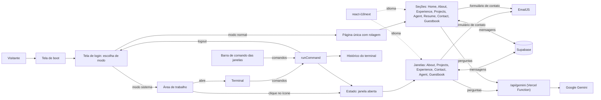
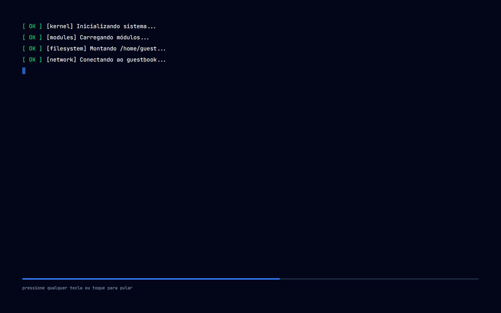
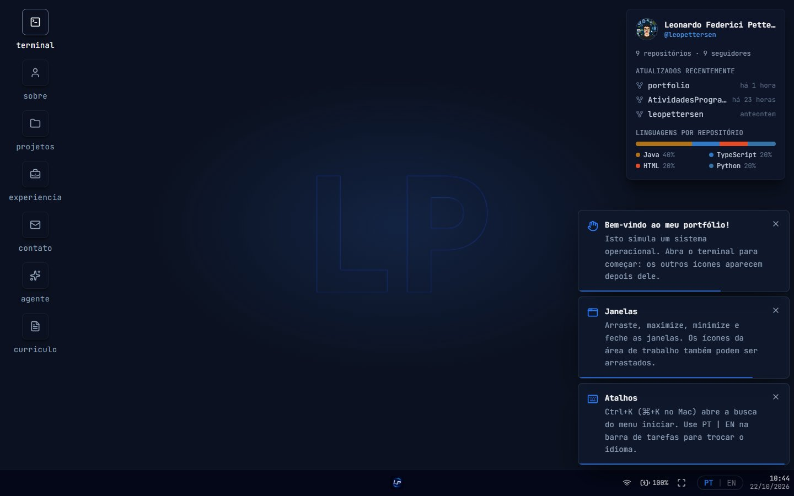

# 💻 Leonardo Pettersen | Portfólio Profissional

> [!NOTE]
> Portfólio profissional com **dois jeitos de navegar**: como um **sistema operacional no navegador**, com terminal, janelas e ícones, ou como uma **página tradicional** com rolagem. **Em poucos segundos, quem visita conhece minha trajetória, meus projetos e como falar comigo.**

🌐 **Acesse o site: [leopettersen.dev](https://www.leopettersen.dev/)**

<table>
  <tr>
    <td width="800px">
      <div align="justify">
        Este é o meu portfólio profissional, criado no <b>Laboratório 01</b> da disciplina de Desenvolvimento e Integração de Aplicações Web (DIAW), do curso de Engenharia de Software da PUC Minas. Depois da tela de inicialização, o visitante escolhe entre o <i>modo sistema</i>, em que explora as seções digitando comandos no terminal ou clicando nos ícones da área de trabalho, e o <i>modo normal</i>, uma página única com tema claro e escuro e currículo em PDF. Nos dois modos é possível conversar com um <b>agente de IA</b> que responde sobre mim em primeira pessoa, deixar um recado no <b>guestbook</b> e me enviar uma mensagem pelo formulário de contato. O site é <i>bilíngue</i> (português e inglês) e <i>responsivo</i>.
      </div>
    </td>
    <td>
      <div>
        
      </div>
    </td>
  </tr>
</table>

---

## 🚧 Status do Projeto

🚀 Site publicado na Vercel. Sofrendo ajustes e adicionando novas funções continuamente.

[](https://github.com/leopettersen/portfolio/actions/workflows/keep-supabase-awake.yml)


---

## 📚 Índice

- [Status do Projeto](#-status-do-projeto)
- [Links Úteis](#-links-úteis)
- [Sobre o Projeto](#-sobre-o-projeto)
- [Como usar o site](#️-como-usar-o-site)
- [Funcionalidades Principais](#-funcionalidades-principais)
- [Tecnologias Utilizadas](#-tecnologias-utilizadas)
- [Arquitetura](#-arquitetura)
- [Instalação e Execução](#-instalação-e-execução)
- [Banco de Dados (Guestbook)](#️-banco-de-dados-guestbook)
- [Deploy](#-deploy)
- [Estrutura de Pastas](#-estrutura-de-pastas)
- [Protótipos](#-protótipos)
- [Demonstração](#-demonstração)
- [Documentações utilizadas](#-documentações-utilizadas)
- [Autor](#-autor)
- [Agradecimentos](#-agradecimentos)
- [Licença](#-licença)

---

## 🔗 Links Úteis

* 🌐 **Site publicado:** [leopettersen.dev](https://www.leopettersen.dev/)
* 🎨 **Protótipos no Figma:** [Wireframe Portfólio](https://www.figma.com/design/RagNM3PaJglaInWaZBa3Uk/Wireframe-Portif%C3%B3lio?node-id=0-1&t=LONNOAM8aQx4MY8Z-1)
* 📦 **Repositório:** [leopettersen/portfolio](https://github.com/leopettersen/portfolio)

---

## 📝 Sobre o Projeto

Este projeto é o meu portfólio profissional: um site onde reúno minha trajetória, projetos, experiências e formas de contato em um só lugar. Foi desenvolvido como o **Laboratório 01** da disciplina de Desenvolvimento e Integração de Aplicações Web (DIAW), do curso de Engenharia de Software da PUC Minas, e continua como meu portfólio de fato depois da entrega.

O site abre com uma tela de inicialização (boot) e chega a uma tela de login, que pergunta como o visitante prefere ver o portfólio. No **modo sistema**, em vez de um site tradicional com menu e rolagem, a interface imita um **sistema operacional**: a área de trabalho começa com um único atalho, o terminal. Ao abrir o terminal, os demais ícones aparecem. A partir daí, o visitante explora o conteúdo de dois jeitos: digitando comandos (`about`, `projects`, `experience`, `contact`, `agent`) ou clicando nos ícones. Cada seção abre em uma janela que pode ser arrastada, maximizada e fechada. No **modo normal**, o mesmo conteúdo aparece em uma página única com rolagem, menu fixo, tema claro e escuro e o currículo em PDF.

A ideia é que quem chega entenda em poucos segundos quem eu sou, veja meus projetos e experiências e consiga entrar em contato. O site é bilíngue (português e inglês), responsivo (celular, tablet e computador) e tem um **guestbook**, onde qualquer pessoa pode deixar uma mensagem pública, e um **agente de IA**, que usa o Google Gemini para responder perguntas sobre mim em primeira pessoa.
O site é aberto a qualquer pessoa, sem cadastro nem login. Por isso o foco está em ser claro, rápido de navegar e fácil de contatar.

---

## 🕹️ Como usar o site

1. **Ligue o sistema:** acesse [leopettersen.dev](https://www.leopettersen.dev/). A tela de inicialização aparece sozinha. Para pular, aperte qualquer tecla ou toque na tela.
2. **Escolha o modo:** na tela de login, escolha **Sistema** (terminal, janelas e ícones) ou **Normal** (página tradicional com rolagem).

### 🖥️ Modo sistema

1. **Abra o terminal:** clique no ícone `terminal` da área de trabalho. Os demais ícones aparecem.
2. **Navegue:** clique nos ícones, nos atalhos do terminal ou digite um comando e aperte Enter.
3. **Troque o idioma** (PT/EN) na barra superior. A escolha fica salva no navegador.
4. **Troque de modo** pelo botão **Trocar de modo** da barra superior ou com o comando `logout`, que voltam para a tela de login.

| Comando | O que faz |
| :--- | :--- |
| `about` | Abre a janela **Sobre Mim** |
| `projects` | Abre a linha do tempo de **Projetos** |
| `experience` | Abre as **Experiências** |
| `contact` | Abre os **Contatos** e o formulário de mensagem |
| `agent` | Abre o **Agente IA**, para fazer perguntas sobre mim |
| `guestbook` | Abre o **Guestbook** (comando escondido: só aparece no `help`) |
| `help` | Lista os comandos disponíveis |
| `clear` | Limpa o histórico do terminal |
| `close` | Fecha a janela aberta |
| `logout` (ou `exit`) | Volta para a tela de login, para escolher outro modo |

A barra de comando no rodapé das janelas aceita os mesmos comandos, então dá para trocar de seção sem voltar ao terminal.

No celular, os ícones ficam em uma grade, as janelas ocupam a tela inteira e o botão **Voltar** fecha a janela.

### 📄 Modo normal

1. **Navegue:** role a página ou use o menu fixo no topo para ir direto a uma seção (no celular, o menu abre pelo botão ☰).
2. **Personalize:** no menu, troque o idioma (PT/EN) e alterne entre tema claro e escuro. As duas escolhas ficam salvas no navegador.
3. **Veja o currículo:** o botão **Currículo** leva ao PDF, que pode ser ampliado, baixado ou aberto em uma nova aba.
4. **Troque de modo** pelo ícone de monitor no menu, que volta para a tela de login.

Na seção de projetos, em telas a partir de 1024px, os cards se empilham: conforme a rolagem, cada projeto sobe e cobre o anterior.

---

## ✨ Funcionalidades Principais

- 🖥️ **Tela de inicialização (boot):** simula a partida de um sistema operacional, em poucos segundos e com opção de pular.
- 🔀 **Dois modos de navegação:** uma tela de login permite escolher entre o modo sistema e o modo normal, e é possível trocar de modo a qualquer momento.
- 🪟 **Área de trabalho interativa:** ícones e janelas arrastáveis no computador; janelas com botões de fechar, minimizar e maximizar.
- ⌨️ **Terminal com comandos:** histórico, atalhos clicáveis e os comandos listados acima, também disponíveis na barra de comando de cada janela.
- 📄 **Modo normal:** página única com as seções Início, Sobre, Experiência, Projetos, Agente IA, Currículo, Contato e Guestbook, menu fixo, barra de progresso da rolagem e cards de projetos que se empilham ao rolar.
- 🌗 **Tema claro e escuro (modo normal):** segue a preferência do sistema no primeiro acesso e lembra a escolha do visitante.
- 🌐 **Bilíngue (PT/EN):** interface e conteúdos nos dois idiomas, com o idioma escolhido lembrado pelo navegador (o primeiro acesso é sempre em português).
- 👤 **Sobre Mim:** apresentação, formação, interesses e objetivos profissionais.
- 🕒 **Projetos em linha do tempo:** do mais antigo ao mais recente, com descrição, tecnologias, link do GitHub e imagem ou GIF.
- 💼 **Experiências:** organização, cargo, período, modelo de trabalho, descrição e habilidades.
- 🤖 **Agente IA:** responde em primeira pessoa, com a resposta aparecendo enquanto é gerada, usando só as informações do meu perfil e no idioma escolhido. Tem limite de perguntas por visitante.
- 📑 **Currículo em PDF (modo normal):** visualização no próprio site, com zoom, download e opção de abrir em nova aba.
- 📨 **Contato:** ícones clicáveis (e-mail, WhatsApp, LinkedIn e GitHub) e formulário com validação, enviado por e-mail via EmailJS.
- 💬 **Guestbook:** mensagens públicas armazenadas no Supabase, com botão "carregar mais", intervalo mínimo entre envios e campo-isca contra robôs.
- 📱 **Responsivo:** layout adaptado a celular, tablet e computador.

---

## 🛠 Tecnologias Utilizadas

### 💻 Front-end

* **Biblioteca:** [React](https://react.dev/)
* **Linguagem:** [TypeScript](https://www.typescriptlang.org/)
* **Build Tool:** [Vite](https://vite.dev/)
* **Estilização:** [Tailwind CSS](https://tailwindcss.com/)
* **Animações:** [Motion](https://motion.dev/)
* **Visualização de PDF:** [react-pdf](https://github.com/wojtekmaj/react-pdf)
* **Ícones:** [Lucide](https://lucide.dev/) e [Devicon](https://devicon.dev/)
* **Fonte:** [Geist](https://vercel.com/font) (via Fontsource)
* **Internacionalização (PT/EN):** [i18next](https://www.i18next.com/) e [react-i18next](https://react.i18next.com/)

### 🗄️ Dados e Serviços

O único código que roda no servidor é uma função serverless da Vercel (`app/api/gemini.ts`), que chama o Gemini sem expor a chave no navegador. Os serviços externos são:

* **Banco de dados (guestbook):** [Supabase](https://supabase.com/)
* **Envio de e-mail (formulário de contato):** [EmailJS](https://www.emailjs.com/)
* **Inteligência artificial (agente):** [Google Gemini](https://ai.google.dev/)

### ⚙️ Infraestrutura e Ferramentas

* **Containerização (execução local):** [Docker](https://www.docker.com/) e Docker Compose
* **Hospedagem e função serverless:** [Vercel](https://vercel.com/)
* **Automação:** [GitHub Actions](https://github.com/features/actions) (mantém o Supabase ativo)
* **Análise estática:** [oxlint](https://oxc.rs/docs/guide/usage/linter)
* **Protótipos:** [Figma](https://www.figma.com/)
* **Versionamento:** [Git](https://git-scm.com/) e [GitHub](https://github.com/)

### 📦 Dependências do projeto

Versões conforme o `app/package.json`.

| Pacote | Versão | Para que serve |
| :--- | :--- | :--- |
| `react`, `react-dom` | ^19.2.8 | Biblioteca de interface |
| `tailwindcss`, `@tailwindcss/vite` | ^4.3.3 | Estilização por classes utilitárias |
| `i18next` | ^26.4.2 | Motor de internacionalização |
| `react-i18next` | ^17.0.15 | Integração do i18next com o React |
| `i18next-browser-languagedetector` | ^8.2.1 | Lembra o idioma escolhido no navegador |
| `@supabase/supabase-js` | ^2.117.2 | Cliente do Supabase (guestbook) |
| `@emailjs/browser` | ^5.0.2 | Envio de e-mail do formulário de contato |
| `lucide-react` | ^1.49.0 | Ícones |
| `motion` | ^14.3.0 | Animações e efeitos ligados à rolagem (modo normal) |
| `react-pdf` | ^11.0.0 | Exibição do currículo em PDF (modo normal) |
| `devicon` | ^2.17.0 | Ícones das tecnologias (modo normal) |
| `@fontsource-variable/geist` | ^5.3.0 | Fonte Geist (modo normal) |

**Desenvolvimento:** `typescript` (~6.0.2), `vite` (^8.3.0), `@vitejs/plugin-react` (^6.1.1), `oxlint` (^1.81.0), `@types/react`, `@types/react-dom` e `@types/node`.

---

## 🏗 Arquitetura

### Visão geral

O projeto é uma **SPA (Single Page Application)** em React e TypeScript, construída com Vite e publicada na Vercel. O guestbook e o envio de e-mail são chamados diretamente pelo front-end, usando Supabase e EmailJS. O agente de IA é a única parte com código no servidor: o navegador chama a rota `/api/gemini` do próprio site, e quem fala com o Gemini é uma **Vercel Function** (em produção) ou um plugin do `vite.config.ts` (em `npm run dev` e `npm run preview`). As duas usam a mesma lógica, que fica em `app/api/_gemini.ts`.

### Principais componentes

- **`App`:** controla a etapa atual: tela de boot, tela de login (escolha de modo), área de trabalho (modo sistema) ou página única (modo normal).
- **`LoginScreen`:** tela que pergunta qual modo o visitante prefere.
- **`DesktopLayout`:** dono do estado do modo sistema. Guarda qual janela está aberta, se os ícones já foram liberados, o histórico do terminal e a função que executa os comandos.
- **`DesktopIcon`:** ícone da área de trabalho, arrastável.
- **`Window`:** janela padrão, com barra de título arrastável, botões de fechar, minimizar e maximizar e barra de comando no rodapé.
- **`Terminal` e `CommandPrompt`:** o terminal mostra apresentação, atalhos e histórico; o `CommandPrompt` é a linha de comando, compartilhada entre o terminal e o rodapé das janelas.
- **`StandardPortfolio`:** a página do modo normal, com header, seções e rodapé. É carregada sob demanda (`lazy`), só quando o visitante escolhe esse modo.
- **`pages/`:** o conteúdo de cada janela do modo sistema (About, Projects, Experience, Contact, Agent e Guestbook).
- **`components/standard/sections/`:** as seções do modo normal (Home, About, Experience, Projects, Agent, Resume, Contact e Guestbook).
- **`data/`:** a lista de seções, os contatos, o app do terminal e o mapa de ícones das tecnologias.
- **`hooks/`:** a lógica compartilhada entre os dois modos, como a conversa com o agente (`useAgentChat`) e o guestbook (`useGuestbook`).
- **`services/`:** o acesso ao Supabase, as funções do guestbook e a chamada à rota do agente.
- **`i18n/`:** configuração do i18next e os textos e conteúdos (sobre, projetos e experiências) em português e inglês.
- **`api/`:** a função serverless do agente, a lógica compartilhada com o Vite e o perfil que o agente usa para responder.

### Fluxo de navegação

Não há roteamento por URL: o site inteiro vive em uma única tela. A etapa atual (boot, login, modo sistema ou modo normal) é um **estado local do React** no `App`.

No modo sistema, a navegação é controlada por um estado local no `DesktopLayout`, que guarda qual janela está aberta (o terminal, uma seção ou nenhuma). Ícones, atalhos e comandos não têm lógicas separadas: todos terminam em **uma função só** (`runCommand`), que atualiza esse estado. Digitar `projects` no terminal, digitar no rodapé de uma janela ou clicar no ícone tem o mesmo efeito. O `help`, o `clear` e os comandos desconhecidos escrevem no histórico do terminal, que também mora no `DesktopLayout` e por isso não se perde quando uma janela abre e fecha. O `logout` (ou `exit`) devolve o visitante para a tela de login.

A lista de seções (usada nos ícones e nos comandos) fica centralizada em `data/sections.ts`, de modo que adicionar uma seção nova significa registrá-la nesse arquivo, nos tipos do projeto e no mapa de páginas do `DesktopLayout`.

No modo normal, todas as seções ficam na mesma página, e o menu leva a cada uma por âncoras (`#about`, `#projects`...).

### Idioma

O `react-i18next` guarda o idioma atual e a escolha do visitante no navegador. Ele traduz os textos da interface (rótulos, botões, mensagens do terminal e do formulário) e também os conteúdos longos (sobre, experiências e projetos), que ficam nos arquivos `i18n/locales/pt.ts` e `en.ts`. O arquivo em inglês é tipado a partir do português (`typeof pt`), então um conteúdo sem tradução não compila. O agente recebe o idioma atual e responde nele.

### Decisões arquiteturais

- **Back-end mínimo, só para o agente:** o site só precisa de um banco para o guestbook e de envio de e-mail, e ambos são cobertos por serviços prontos. A exceção é o agente: a chave do Gemini não pode ir para o navegador, então uma Vercel Function faz a chamada.
- **Dois modos sobre o mesmo conteúdo:** o modo sistema e o modo normal leem os mesmos textos do i18n e usam os mesmos hooks e serviços, então um projeto ou experiência novo aparece nos dois.
- **Modo normal carregado sob demanda:** quem escolhe o modo sistema não baixa o código do modo normal (como o visualizador de PDF).
- **Navegação por estado local, sem biblioteca de rotas:** o site é uma tela única, então não há páginas distintas que justifiquem um roteador. Isso mantém o projeto mais simples e com menos dependências.
- **Conteúdo fixo no código:** projetos e experiências mudam pouco, então ficam versionados junto ao projeto, sem depender de banco.
- **Comandos em inglês, interface traduzida:** os comandos (`about`, `help`...) são o mesmo nos dois idiomas, e só os textos mudam.
- **Segurança do guestbook no banco:** as regras de acesso (RLS) e os limites de tamanho valem no próprio Supabase, e não só no navegador. Como a chave pública do Supabase fica no código do cliente por natureza, a proteção vem dessas regras.
- **Chaves públicas no front-end:** só variáveis `VITE_*` públicas entram no código do navegador. A `GEMINI_API_KEY` não tem o prefixo `VITE_` de propósito, para ficar só no servidor. Chaves secretas (como a `service_role` do Supabase e a chave privada do EmailJS) nunca são usadas.
- **Agente preso ao perfil:** o Gemini recebe como instrução o perfil escrito em `app/api/_perfil.ts` e a regra de usar só essas informações, para não inventar dados.
- **Docker só para execução local:** a Vercel faz o build e o deploy do site sem containers.
- **Boot curto e pulável:** a tela de inicialização reforça o conceito, mas não atrasa quem tem pressa.
- **Celular sem arrastar:** arrastar com o dedo conflita com a rolagem, então no celular os ícones são fixos e as janelas ocupam a tela inteira.

### Trade-offs

- Como não há rotas, cada seção não tem URL própria: não é possível compartilhar um link direto para Projects, e o botão voltar do navegador não fecha janelas.
- Atualizar um projeto ou experiência exige um novo deploy.
- A moderação do guestbook é manual (apagar linhas no painel do Supabase). O intervalo entre envios e o campo-isca desanimam o abuso casual, mas quem chamar a API diretamente os contorna.
- Só uma janela fica aberta por vez, e as posições de janelas e ícones não são salvas entre visitas.
- Os conteúdos extensos (sobre, projetos e experiências) ficam centralizados diretamente nos arquivos de idioma (`pt.ts` e `en.ts`). A tipagem rigorosa do TypeScript vincula o arquivo em inglês ao português, impossibilitando que o deploy seja feito se faltar a tradução de algum campo.
- O limite de perguntas do agente (8 por minuto e 100 por dia, por IP) fica na memória da função: é um freio, não uma garantia, porque cada instância da função tem a sua contagem.
- O perfil do agente (`app/api/_perfil.ts`) é separado dos textos do site, então uma mudança no conteúdo precisa ser feita nos dois lugares.
- O Supabase gratuito pausa projetos sem uso, então um workflow do GitHub Actions consulta o banco a cada 12 horas para mantê-lo ativo.

### Diagrama



---

## 🔧 Instalação e Execução

Para só conhecer o projeto, basta acessar o [site publicado](https://www.leopettersen.dev/). Para rodá-lo na sua máquina:

### Pré-requisitos

* **Git**
* **Node.js 22 (LTS)** para rodar sem Docker, ou **Docker** com **Docker Compose** para rodar em contêiner
* Contas gratuitas no **Supabase** e no **EmailJS**, para obter as chaves usadas nas variáveis de ambiente
* Uma chave do **Google AI Studio**, para o agente de IA (opcional: sem ela, o resto do site funciona normalmente)

### 📦 Instalação

```bash
git clone https://github.com/leopettersen/portfolio.git
cd portfolio
```

### 🔑 Variáveis de Ambiente

O projeto fica na pasta `app/`. A partir da raiz do repositório, copie o arquivo de exemplo e preencha com os seus valores:

```bash
cp app/.env.example app/.env
```

| Variável | Descrição |
| :--- | :--- |
| `VITE_SUPABASE_URL` | URL do projeto no Supabase. |
| `VITE_SUPABASE_ANON_KEY` | Chave pública do Supabase (a *publishable key* ou a chave `anon`). |
| `VITE_EMAILJS_SERVICE_ID` | ID do serviço de e-mail no EmailJS. |
| `VITE_EMAILJS_TEMPLATE_ID` | ID do template de e-mail no EmailJS. |
| `VITE_EMAILJS_PUBLIC_KEY` | Chave pública do EmailJS. |
| `GEMINI_API_KEY` | Chave do [Google AI Studio](https://aistudio.google.com/apikey), usada só no servidor pelo agente. |
| `GEMINI_MODEL` | Opcional. Modelo do Gemini usado pelo agente (padrão: `gemini-3.5-flash-lite`). |

> [!IMPORTANT]
> O arquivo `.env` não é versionado. Use apenas chaves **públicas** nas variáveis `VITE_*`, porque o Vite as inclui no código entregue ao navegador. A `GEMINI_API_KEY` é secreta e **não** deve receber o prefixo `VITE_`. **Nunca** use a `service_role` do Supabase nem a chave privada do EmailJS.

O template do EmailJS deve usar as variáveis `{{name}}`, `{{email}}` e `{{message}}`, e o campo *Reply To* deve apontar para `{{email}}`.

### ⚡ Como Executar

**Com Docker (a partir da raiz do repositório):**

```bash
docker compose up --build
```

O site ficará disponível em **http://localhost:5173**, com recarga automática ao editar o código. Para parar:

```bash
docker compose down
```

Observações sobre o Docker:

- O `app/.env` é espelhado para dentro do contêiner e **não** é gravado na imagem. Depois de alterá-lo, rode `docker compose restart`.
- Depois de instalar uma dependência nova, rode `docker compose up --build --renew-anon-volumes`, para o contêiner usar os `node_modules` atualizados.
- No Windows e no macOS, se a página não recarregar ao editar arquivos, ative a opção `server.watch.usePolling` em `app/vite.config.ts`.

**Sem Docker:**

```bash
cd app
npm install
npm run dev
```

Nos dois casos, a rota `/api/gemini` do agente é atendida pelo próprio servidor do Vite, então o agente funciona localmente se a `GEMINI_API_KEY` estiver no `app/.env`.

### 📜 Scripts disponíveis

Todos os comandos rodam dentro de `app/`.

| Comando | O que faz |
| :--- | :--- |
| `npm run dev` | Inicia o servidor de desenvolvimento do Vite |
| `npm run build` | Verifica os tipos (`tsc -b`) e gera a versão de produção em `dist/` |
| `npm run preview` | Serve localmente a versão gerada pelo build |
| `npm run lint` | Executa a análise estática com o oxlint |

O projeto não tem testes automatizados. A verificação de tipos acontece no `npm run build` (ou, para uma checagem rápida, com `npx tsc -b`).

---

## 🗄️ Banco de Dados (Guestbook)

O guestbook usa uma única tabela no Supabase. Para criá-la, abra o **SQL Editor** do seu projeto e execute:

```sql
create table public.guestbook_messages (
  id bigint generated always as identity primary key,
  name text not null check (char_length(btrim(name)) between 1 and 40),
  message text not null check (char_length(btrim(message)) between 1 and 500),
  created_at timestamptz not null default now()
);

alter table public.guestbook_messages enable row level security;

create policy "Leitura pública do guestbook"
  on public.guestbook_messages for select
  to anon
  using (true);

create policy "Envio público ao guestbook"
  on public.guestbook_messages for insert
  to anon
  with check (
    char_length(btrim(name)) between 1 and 40
    and char_length(btrim(message)) between 1 and 500
  );

grant select, insert on public.guestbook_messages to anon;
```

O que isso garante:

- **Limites no banco:** nome de 1 a 40 caracteres e mensagem de 1 a 500, mesmo para quem ignorar o site e chamar a API direto.
- **Só leitura e envio:** o visitante (papel `anon`) consegue ler e inserir, mas **não existe** política de edição nem de remoção, então ninguém altera ou apaga mensagens pela chave pública.
- **Moderação manual:** mensagens inadequadas são removidas pelo **Table Editor** do Supabase.

Depois, copie a **URL do projeto** e a **chave pública** em *Project Settings* para o `app/.env`.

### Mantendo o Supabase ativo

O plano gratuito do Supabase pausa projetos que ficam sem uso. Para evitar isso, o workflow [`.github/workflows/keep-supabase-awake.yml`](.github/workflows/keep-supabase-awake.yml) consulta uma linha da tabela a cada 12 horas (e também pode ser executado manualmente pela aba *Actions*). Se a consulta falhar, o job falha e a badge **SupabaseAlive** fica vermelha.

Para usá-lo em outro projeto, troque a `SUPABASE_URL` no arquivo do workflow e cadastre a chave pública do Supabase como o secret `SUPABASE_API_KEY` em *Settings > Secrets and variables > Actions* do repositório.

---

## 🚀 Deploy

O site está publicado na **Vercel** em **[leopettersen.dev](https://www.leopettersen.dev/)**, conectada ao repositório do GitHub. Cada atualização na branch principal gera um novo deploy automaticamente.

Configuração do projeto na Vercel:

| Campo | Valor |
| :--- | :--- |
| Framework Preset | Vite |
| Root Directory | `app` |
| Build Command | `npm run build` |
| Output Directory | `dist` |

As cinco variáveis `VITE_*` e as do Gemini (`GEMINI_API_KEY` e, se quiser trocar o modelo, `GEMINI_MODEL`), listadas em [Variáveis de Ambiente](#-variáveis-de-ambiente), são cadastradas em *Project Settings > Environment Variables*. O Vite grava as variáveis `VITE_*` no código durante o build, então qualquer mudança nelas exige um novo deploy. Como o build executa `tsc -b`, qualquer erro de tipo interrompe o deploy.

A Vercel transforma o `app/api/gemini.ts` em uma função serverless, atendida em `/api/gemini`. O `app/vercel.json` aumenta o tempo máximo dessa função para 60 segundos, para respostas mais longas do agente não serem cortadas. Arquivos de `app/api/` que começam com `_` não viram rotas.

---

## 📂 Estrutura de Pastas

```
portfolio/
├── .github/
│   └── workflows/
│       └── keep-supabase-awake.yml  # Consulta o Supabase a cada 12 horas para ele não pausar
├── docs/
│   └── images/
│       ├── wireframes/              # Protótipos das telas (Figma)
│       └── prints/                  # Capturas do site em funcionamento
├── app/                             # Aplicação (projeto Vite)
│   ├── api/                         # Agente de IA no servidor
│   │   ├── gemini.ts                # Vercel Function da rota /api/gemini
│   │   ├── _gemini.ts               # Lógica do agente, usada pela Vercel e pelo Vite
│   │   └── _perfil.ts               # Perfil que o agente usa para responder
│   ├── public/                      # Arquivos estáticos servidos como estão (logo, cursores, currículo em PDF)
│   ├── src/
│   │   ├── assets/                  # Imagens usadas no site
│   │   ├── components/
│   │   │   ├── boot/                # Tela de inicialização (BootScreen)
│   │   │   ├── login/               # Tela de escolha de modo (LoginScreen)
│   │   │   ├── desktop/             # Layout da área de trabalho, ícones, barra superior, relógio e aviso de boas-vindas
│   │   │   ├── terminal/            # Terminal e linha de comando (CommandPrompt)
│   │   │   ├── window/              # Janela padrão (arrastar, minimizar, maximizar, fechar)
│   │   │   ├── standard/            # Modo normal: header, rodapé, cards, tema e dados compartilhados
│   │   │   │   └── sections/        # Seções da página do modo normal
│   │   │   └── ui/                  # Peças reutilizáveis (Tag, LanguageToggle, MarkdownText)
│   │   ├── data/                    # Seções, contatos, app do terminal e ícones das tecnologias
│   │   ├── hooks/                   # Hooks personalizados (useDraggable, useAgentChat, useGuestbook)
│   │   ├── i18n/                    # Configuração do i18next e textos (aqui vivem os dados de sobre, projetos e experiências)
│   │   ├── pages/                   # Conteúdo de cada janela (About, Projects, Experience, Contact, Agent, Guestbook)
│   │   ├── services/                # Cliente do Supabase, funções do guestbook e chamada ao agente
│   │   ├── types/                   # Tipos TypeScript
│   │   ├── App.tsx                  # Componente raiz (boot, login e os dois modos)
│   │   ├── main.tsx                 # Ponto de entrada da aplicação
│   │   └── index.css                # Importação do Tailwind e cores dos temas
│   ├── .dockerignore                # Arquivos que não entram na imagem Docker
│   ├── .env.example                 # Modelo das variáveis de ambiente (sem valores reais)
│   ├── .oxlintrc.json               # Configuração do oxlint
│   ├── Dockerfile                   # Imagem do ambiente de desenvolvimento
│   ├── index.html                   # HTML base da aplicação
│   ├── package.json                 # Dependências e scripts
│   ├── vercel.json                  # Configuração da função do agente na Vercel
│   └── vite.config.ts               # Configuração do Vite (e da rota /api/gemini no desenvolvimento)
├── .gitignore                       # Arquivos ignorados pelo Git (.env, node_modules etc.)
├── docker-compose.yml               # Execução local com Docker
├── LICENSE                          # Licença do projeto
└── README.md                        # Documentação principal
```

---

## 🎨 Protótipos

Os wireframes de média fidelidade foram feitos no [Figma](https://www.figma.com/design/RagNM3PaJglaInWaZBa3Uk/Wireframe-Portif%C3%B3lio?node-id=0-1&t=LONNOAM8aQx4MY8Z-1) e guiaram o layout das janelas e das páginas.

<table>
  <tr>
    <th>Home (desktop)</th>
    <th>Sobre Mim</th>
  </tr>
  <tr>
    <td align="center"></td>
    <td align="center"></td>
  </tr>
  <tr>
    <th>Projetos</th>
    <th>Experiências</th>
  </tr>
  <tr>
    <td align="center"></td>
    <td align="center"></td>
  </tr>
  <tr>
    <th>Contato</th>
    <th>Mobile</th>
  </tr>
  <tr>
    <td align="center"></td>
    <td align="center">
      
      
    </td>
  </tr>
</table>

---

## 🎥 Demonstração

### 🖥️ Desktop

| Tela de boot | Área de trabalho |
| :---: | :---: |
|  |  |

| Terminal | Sobre Mim |
| :---: | :---: |
|  |  |

| Projetos | Experiências |
| :---: | :---: |
|  |  |

| Contato | Guestbook |
| :---: | :---: |
|  |  |

### 📱 Mobile

| Terminal | Projetos |
| :---: | :---: |
|  |  |

---

## 🔗 Documentações utilizadas

* 📖 [React](https://react.dev/)
* 📖 [Vite](https://vite.dev/guide/)
* 📖 [TypeScript](https://www.typescriptlang.org/docs/)
* 📖 [Tailwind CSS](https://tailwindcss.com/docs)
* 📖 [Motion](https://motion.dev/docs/react)
* 📖 [react-pdf](https://github.com/wojtekmaj/react-pdf#readme)
* 📖 [i18next](https://www.i18next.com/) e [react-i18next](https://react.i18next.com/)
* 📖 [Supabase](https://supabase.com/docs)
* 📖 [EmailJS](https://www.emailjs.com/docs/)
* 📖 [Gemini API](https://ai.google.dev/gemini-api/docs)
* 📖 [Lucide](https://lucide.dev/guide/packages/lucide-react)
* 📖 [Docker](https://docs.docker.com/)
* 📖 [Vercel](https://vercel.com/docs) e [Vercel Functions](https://vercel.com/docs/functions)
* 📖 [GitHub Actions](https://docs.github.com/actions)

---

## 👥 Autor

| 👤 Nome | 🖼️ Foto | :octocat: GitHub | 💼 LinkedIn | 📤 E-mail |
|---------|----------|-----------------|-------------|-----------|
| Leonardo Pettersen | <div align="center"></div> | <div align="center"><a href="https://github.com/leopettersen"></a></div> | <div align="center"><a href="https://www.linkedin.com/in/leonardopettersen"></a></div> | <div align="center"><a href="mailto:leonardopettersen465@yahoo.com"></a></div> |

---

## 🙏 Agradecimentos

* [**Engenharia de Software PUC Minas**](https://www.instagram.com/engsoftwarepucminas/?hl=pt) - Pelo apoio institucional e pela estrutura acadêmica.
* [**Prof. Dr. João Paulo Aramuni**](https://github.com/joaopauloaramuni) - Pela orientação na disciplina de Desenvolvimento e Integração de Aplicações Web.

---

## 📄 Licença

Este projeto é distribuído sob a [Licença MIT](./LICENSE).
