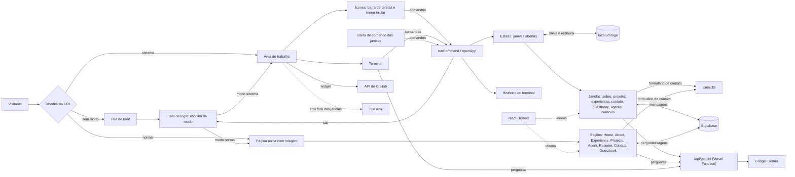

# 💻 Leonardo Pettersen | Portfólio Profissional

> [!NOTE]
> Portfólio profissional com **dois jeitos de navegar**: como um **sistema operacional no navegador**, com terminal, janelas e ícones, ou como uma **página tradicional** com rolagem. **Em poucos segundos, quem visita conhece minha trajetória, meus projetos e como falar comigo.**

🌐 **Acesse o site: [leopettersen.dev](https://www.leopettersen.dev/) || [leopettersen.vercel.app](https://leopettersen.vercel.app/)**

<table>
  <tr>
    <td width="800px">
      <div align="justify">
        Este é o meu portfólio profissional, criado no <b>Laboratório 01</b> da disciplina de Desenvolvimento e Integração de Aplicações Web (DIAW), do curso de Engenharia de Software da PUC Minas. Depois da tela de inicialização, o visitante escolhe entre o <i>modo sistema</i>, em que explora as seções digitando comandos no terminal ou clicando nos ícones da área de trabalho, e o <i>modo normal</i>, uma página única com tema claro e escuro. Nos dois modos dá para ver o currículo em PDF, conversar com um <b>agente de IA</b> que responde sobre mim em primeira pessoa, deixar um recado no <b>guestbook</b> e me enviar uma mensagem pelo formulário de contato. O site é <i>bilíngue</i> (português e inglês) e <i>responsivo</i>.
      </div>
    </td>
    <td>
      <div>
        
      </div>
    </td>
  </tr>
</table>

---

## 🚧 Status do Projeto

🚀 Site publicado na Vercel. Sofrendo ajustes e adicionando novas funções continuamente.

[](https://github.com/leopettersen/portfolio/actions/workflows/keep-supabase-awake.yml)


---

## 📚 Índice

- [Status do Projeto](#-status-do-projeto)
- [Links Úteis](#-links-úteis)
- [Sobre o Projeto](#-sobre-o-projeto)
- [Como usar o site](#️-como-usar-o-site)
- [Funcionalidades Principais](#-funcionalidades-principais)
- [Tecnologias Utilizadas](#-tecnologias-utilizadas)
- [Arquitetura](#-arquitetura)
- [Instalação e Execução](#-instalação-e-execução)
- [Banco de Dados (Guestbook)](#️-banco-de-dados-guestbook)
- [Deploy](#-deploy)
- [Estrutura de Pastas](#-estrutura-de-pastas)
- [Protótipos](#-protótipos)
- [Demonstração](#-demonstração)
- [Documentações utilizadas](#-documentações-utilizadas)
- [Autor](#-autor)
- [Agradecimentos](#-agradecimentos)
- [Licença](#-licença)

---

## 🔗 Links Úteis

* 🌐 **Site publicado:** [leopettersen.dev](https://www.leopettersen.dev/) || [leopettersen.vercel.app](https://leopettersen.vercel.app/)
* 🎨 **Protótipos no Figma:** [Wireframe Portfólio](https://www.figma.com/design/RagNM3PaJglaInWaZBa3Uk/Wireframe-Portif%C3%B3lio?node-id=0-1&t=LONNOAM8aQx4MY8Z-1)
* 📦 **Repositório:** [leopettersen/portfolio](https://github.com/leopettersen/portfolio)

---

## 📝 Sobre o Projeto

Este projeto é o meu portfólio profissional: um site onde reúno minha trajetória, projetos, experiências e formas de contato em um só lugar. Foi desenvolvido como o **Laboratório 01** da disciplina de Desenvolvimento e Integração de Aplicações Web (DIAW), do curso de Engenharia de Software da PUC Minas, e continua como meu portfólio de fato depois da entrega.

O site abre com uma tela de inicialização (boot) e chega a uma tela de login, que pergunta como o visitante prefere ver o portfólio. No **modo sistema**, em vez de um site tradicional com menu e rolagem, a interface imita um **sistema operacional**, com barra de tarefas, menu Iniciar e janelas. A área de trabalho começa com um único atalho, o terminal. Ao abrir o terminal, os demais ícones aparecem. A partir daí, o visitante explora o conteúdo digitando comandos (`sobre`, `projetos`, `experiencia`, `contato`, `agente`...), clicando nos ícones ou buscando no menu Iniciar. Cada seção abre em uma janela que pode ser arrastada, redimensionada, minimizada, maximizada e fechada, e várias podem ficar abertas ao mesmo tempo. No **modo normal**, o mesmo conteúdo aparece em uma página única com rolagem, menu fixo e tema claro e escuro.

A ideia é que quem chega entenda em poucos segundos quem eu sou, veja meus projetos e experiências e consiga entrar em contato. O site é bilíngue (português e inglês), responsivo (celular, tablet e computador) e tem um **guestbook**, onde qualquer pessoa pode deixar uma mensagem pública, e um **agente de IA**, que usa o Google Gemini para responder perguntas sobre mim em primeira pessoa.
O site é aberto a qualquer pessoa, sem cadastro nem login. Por isso o foco está em ser claro, rápido de navegar e fácil de contatar.

---

## 🕹️ Como usar o site

1. **Ligue o sistema:** acesse [leopettersen.dev](https://www.leopettersen.dev/) || [leopettersen.vercel.app](https://leopettersen.vercel.app/). A tela de inicialização aparece sozinha. Para pular, aperte qualquer tecla ou toque na tela.
2. **Escolha o modo:** na tela de login, escolha **Sistema** (terminal, janelas e ícones) ou **Normal** (página tradicional com rolagem).

> [!TIP]
> Para abrir direto em um modo, pulando o boot e o login, use [leopettersen.dev/?mode=sistema](https://www.leopettersen.dev/?mode=sistema) ou [leopettersen.dev/?mode=normal](https://www.leopettersen.dev/?mode=normal) (também valem `system` e `standard`). A barra de endereço acompanha o modo atual, então recarregar a página mantém o modo escolhido.

### 🖥️ Modo sistema

1. **Abra o terminal:** clique no ícone `terminal` da área de trabalho. Os demais ícones aparecem. Na primeira visita, dicas de uso aparecem como notificações no canto inferior direito.
2. **Navegue:** clique nos ícones, nos atalhos do terminal, digite um comando e aperte Enter, ou abra o **menu Iniciar** (logo na barra de tarefas ou **Ctrl+K** / **⌘+K**) e busque por apps e comandos. Se a busca não encontrar nada, ela oferece **Perguntar ao agente**.
3. **Organize as janelas:** várias podem ficar abertas ao mesmo tempo. Arraste pela barra de título, redimensione pelas bordas e cantos, dê duplo clique no título para maximizar e aperte **Esc** para fechar a janela em foco (dentro de um campo, o primeiro Esc só tira o foco). Na barra de tarefas, clicar em uma janela traz ela para a frente ou a minimiza.
4. **Use o botão direito:** na área de trabalho (abrir o terminal, organizar ícones, trocar idioma, tela cheia, copiar o link, ver o código-fonte, informações do sistema e redefinir a área de trabalho), na barra de título e nos botões da barra de tarefas.
5. **Veja a bandeja:** no canto direito da barra de tarefas ficam a conexão, a bateria (quando o navegador informa), a tela cheia, o idioma (PT/EN) e o relógio.
6. **Desligue, reinicie ou troque de modo** pelo botão de energia do menu Iniciar, ou volte à tela de login com o comando `sair`.

A área de trabalho fica salva no navegador: posições dos ícones, posição e tamanho de cada janela, janelas abertas e minimizadas. Ela continua igual ao trocar de modo, reiniciar ou desligar, e o botão direito > **Redefinir área de trabalho** volta ao padrão. No canto superior direito, um widget mostra meu perfil do GitHub, os repositórios atualizados recentemente e as linguagens que mais uso.

| Comando | O que faz |
| :--- | :--- |
| `sobre` | Abre a janela **sobre.md**: quem eu sou, formação e objetivos |
| `projetos` | Abre **projetos/**, a linha do tempo de projetos |
| `experiencia` | Abre **experiencia/**, minha trajetória profissional |
| `contato` | Abre **contato.sh**, com os contatos e o formulário de mensagem |
| `guestbook` | Abre o **guestbook.md**, o mural de recados |
| `agente` | Abre o **agente.md**, para conversar com o agente de IA |
| `curriculo` | Abre o **curriculo.pdf** |
| `perguntar <pergunta>` | Pergunta ao agente e mostra a resposta no próprio terminal, mantendo a conversa |
| `ajuda` | Lista os comandos, com uma descrição de cada um |
| `limpar` | Limpa o histórico do terminal e a conversa do `perguntar` |
| `fechar` | Fecha a janela em foco |
| `idioma [pt\|en]` | Mostra ou troca o idioma |
| `neofetch` | Mostra as informações do sistema |
| `reiniciar` / `desligar` | Reinicia ou desliga o sistema |
| `sair` (ou `exit`) | Volta para a tela de login, para escolher outro modo |

Todos os comandos também aceitam o nome em inglês (`about`, `projects`, `ask`, `help`...), em qualquer idioma. No terminal, **↑/↓** navegam pelos últimos comandos, **Tab** completa o comando (as letras que faltam aparecem apagadas enquanto se digita) e **←/→** movem o cursor. A barra de comando no rodapé das janelas aceita os mesmos comandos.

No celular, as janelas ocupam a tela acima da barra de tarefas, o botão **Voltar** fecha a janela e a barra de tarefas alterna entre as janelas abertas. Arrastar, redimensionar, os menus de botão direito e o widget do GitHub ficam só no computador.

### 📄 Modo normal

1. **Navegue:** role a página ou use o menu fixo no topo para ir direto a uma seção. O menu destaca a seção que está na tela. No celular, o menu abre pelo botão ☰ e fecha com Esc ou com um toque fora dele.
2. **Personalize:** no menu, troque o idioma (PT/EN) e alterne entre tema claro e escuro. As duas escolhas ficam salvas no navegador.
3. **Veja o currículo:** o botão **Currículo** leva ao PDF, que pode ser ampliado, baixado ou aberto em uma nova aba.
4. **Troque de modo** pelo ícone de monitor no menu, que volta para a tela de login.

Na seção de projetos, em telas a partir de 1024px, os cards se empilham: conforme a rolagem, cada projeto sobe e cobre o anterior. Projetos publicados têm o botão **Ver online**, além do link do GitHub.

---

## ✨ Funcionalidades Principais

- 🖥️ **Tela de inicialização (boot):** simula a partida de um sistema operacional, em poucos segundos e com opção de pular.
- 🔀 **Dois modos de navegação:** uma tela de login permite escolher entre o modo sistema e o modo normal, é possível trocar de modo a qualquer momento e o link `?mode=` abre direto em um deles.
- 🪟 **Área de trabalho no estilo Windows 11:** barra de tarefas com menu Iniciar, busca, botão de energia (reiniciar, desligar e trocar de modo) e bandeja com conexão, bateria, tela cheia, idioma e relógio. Papel de parede feito só com CSS.
- 🗂️ **Várias janelas:** abrir várias ao mesmo tempo, arrastar, redimensionar pelas bordas e cantos, minimizar, maximizar com duplo clique, fechar com Esc e menus de botão direito, com animações que respeitam o "reduzir movimento" do sistema.
- 💾 **Área de trabalho salva:** posições dos ícones, posição e tamanho das janelas e janelas abertas ficam no navegador entre visitas.
- ⌨️ **Terminal com comandos:** histórico com ↑/↓, autocompletar com Tab (com sugestão em letras apagadas), ajuda com a descrição de cada comando, `neofetch`, perguntas ao agente no próprio terminal e um easter egg.
- 🔔 **Notificações:** dicas de boas-vindas na primeira visita e avisos de conexão perdida e recuperada.
- 🐙 **Widget do GitHub:** perfil, repositórios atualizados recentemente e linguagens, direto da API pública do GitHub.
- 🧯 **Recuperação de erros:** se uma janela quebra, só ela mostra "O aplicativo parou de funcionar", com a opção de tentar de novo. Um erro geral mostra uma tela azul com a opção de reiniciar ou abrir o modo normal.
- 📄 **Modo normal:** página única com as seções Início, Sobre, Experiência, Projetos, Agente IA, Currículo, Contato e Guestbook, menu fixo que destaca a seção atual, barra de progresso da rolagem e cards de projetos que se empilham ao rolar.
- 🌗 **Tema claro e escuro (modo normal):** segue a preferência do sistema no primeiro acesso e lembra a escolha do visitante.
- 🌐 **Bilíngue (PT/EN):** interface, conteúdos, nomes de comandos e janelas e o título da aba nos dois idiomas, com o idioma escolhido lembrado pelo navegador (o primeiro acesso é sempre em português).
- 👤 **Sobre Mim:** apresentação, formação, interesses e objetivos profissionais.
- 🕒 **Projetos em linha do tempo:** do mais antigo ao mais recente, com descrição, tecnologias, link do GitHub, link do site publicado (quando houver) e imagem.
- 💼 **Experiências:** organização, cargo, período, modelo de trabalho, descrição e habilidades.
- 🤖 **Agente IA:** responde em primeira pessoa, com a resposta aparecendo enquanto é gerada, usando só as informações do meu perfil e no idioma escolhido. Tem limite de perguntas por visitante, na função e no firewall da Vercel.
- 📑 **Currículo em PDF:** visualização no próprio site, nos dois modos, com zoom, download e opção de abrir em nova aba.
- 📨 **Contato:** ícones clicáveis (e-mail, WhatsApp, LinkedIn e GitHub) e formulário com validação, enviado por e-mail via EmailJS, com campo-isca contra robôs, bloqueio de navegadores automatizados e intervalo mínimo de 60 segundos entre envios.
- 💬 **Guestbook:** mensagens públicas armazenadas no Supabase, com botão "carregar mais", intervalo mínimo de 30 segundos entre envios e campo-isca contra robôs.
- ♿ **Acessibilidade:** navegação por teclado nos menus, foco devolvido ao fechar menus e diálogos, rótulos para leitores de tela e respeito ao "reduzir movimento".
- 🔎 **SEO:** metadados para compartilhamento (Open Graph e Twitter/X), endereço canônico, dados estruturados (JSON-LD), `robots.txt` e `sitemap.xml`.
- 📱 **Responsivo:** layout adaptado a celular, tablet e computador.

---

## 🛠 Tecnologias Utilizadas

### 💻 Front-end

* **Biblioteca:** [React](https://react.dev/)
* **Linguagem:** [TypeScript](https://www.typescriptlang.org/)
* **Build Tool:** [Vite](https://vite.dev/)
* **Estilização:** [Tailwind CSS](https://tailwindcss.com/)
* **Animações:** [Motion](https://motion.dev/)
* **Visualização de PDF:** [react-pdf](https://github.com/wojtekmaj/react-pdf)
* **Ícones:** [Lucide](https://lucide.dev/) e [Devicon](https://devicon.dev/)
* **Fontes (via Fontsource):** [JetBrains Mono](https://www.jetbrains.com/lp/mono/) no modo sistema, [Geist](https://vercel.com/font) no texto do modo normal e [Orbitron](https://fonts.google.com/specimen/Orbitron) nos títulos do modo normal
* **Internacionalização (PT/EN):** [i18next](https://www.i18next.com/) e [react-i18next](https://react.i18next.com/)

### 🗄️ Dados e Serviços

O único código que roda no servidor é uma função serverless da Vercel (`app/api/gemini.ts`), que chama o Gemini sem expor a chave no navegador. Os serviços externos são:

* **Banco de dados (guestbook):** [Supabase](https://supabase.com/), acessado direto pela API REST, sem SDK
* **Envio de e-mail (formulário de contato):** [EmailJS](https://www.emailjs.com/)
* **Inteligência artificial (agente):** [Google Gemini](https://ai.google.dev/)
* **Widget do GitHub:** [API REST pública do GitHub](https://docs.github.com/rest), chamada direto do navegador

### ⚙️ Infraestrutura e Ferramentas

* **Containerização (execução local):** [Docker](https://www.docker.com/) e Docker Compose
* **Hospedagem, função serverless e firewall:** [Vercel](https://vercel.com/)
* **Automação:** [GitHub Actions](https://github.com/features/actions) (mantém o Supabase ativo)
* **Análise estática:** [oxlint](https://oxc.rs/docs/guide/usage/linter)
* **Protótipos:** [Figma](https://www.figma.com/)
* **Versionamento:** [Git](https://git-scm.com/) e [GitHub](https://github.com/)

### 📦 Dependências do projeto

Versões conforme o `app/package.json`.

| Pacote | Versão | Para que serve |
| :--- | :--- | :--- |
| `react`, `react-dom` | ^19.2.8 | Biblioteca de interface |
| `tailwindcss`, `@tailwindcss/vite` | ^4.3.3 | Estilização por classes utilitárias |
| `i18next` | ^26.4.2 | Motor de internacionalização |
| `react-i18next` | ^17.0.15 | Integração do i18next com o React |
| `i18next-browser-languagedetector` | ^8.2.1 | Lembra o idioma escolhido no navegador |
| `@emailjs/browser` | ^5.0.2 | Envio de e-mail do formulário de contato |
| `lucide-react` | ^1.49.0 | Ícones |
| `motion` | ^14.3.0 | Barra de progresso da rolagem (modo normal) |
| `react-pdf` | ^11.0.0 | Exibição do currículo em PDF (nos dois modos) |
| `devicon` | ^2.17.0 | Ícones das tecnologias, usados como SVGs individuais pintados com a cor do tema |
| `@fontsource-variable/jetbrains-mono` | ^5.3.0 | Fonte JetBrains Mono (modo sistema) |
| `@fontsource-variable/geist` | ^5.3.0 | Fonte Geist (texto do modo normal) |
| `@fontsource-variable/orbitron` | ^5.3.0 | Fonte Orbitron (títulos do modo normal) |

**Desenvolvimento:** `typescript` (~6.0.2), `vite` (^8.3.0), `@vitejs/plugin-react` (^6.1.1), `oxlint` (^1.81.0), `@types/react`, `@types/react-dom` e `@types/node`.

---

## 🏗 Arquitetura

### Visão geral

O projeto é uma **SPA (Single Page Application)** em React e TypeScript, construída com Vite e publicada na Vercel. O guestbook, o envio de e-mail e o widget do GitHub são chamados diretamente pelo front-end, usando a API REST do Supabase, o EmailJS e a API pública do GitHub. O agente de IA é a única parte com código no servidor: o navegador chama a rota `/api/gemini` do próprio site, e quem fala com o Gemini é uma **Vercel Function** (em produção) ou um plugin do `vite.config.ts` (em `npm run dev` e `npm run preview`). As duas usam a mesma lógica, que fica em `app/api/_gemini.ts`.

### Principais componentes

- **`App`:** controla a etapa atual: tela de boot, tela de login (escolha de modo), área de trabalho (modo sistema), página única (modo normal) ou as telas de reiniciar e desligar. Lê o `?mode=` na entrada e mantém a URL em dia com o modo atual.
- **`LoginScreen`:** tela que pergunta qual modo o visitante prefere.
- **`BootScreen`, `PowerScreen` e `CrashScreen`:** a inicialização, as telas de reiniciar e desligar e a tela azul mostrada quando o modo sistema quebra fora de uma janela.
- **`DesktopLayout`:** dono do estado do modo sistema. Guarda as janelas abertas (ordem, minimizadas e layout de cada uma), se os ícones já foram liberados, as posições dos ícones, o histórico do terminal e a função que executa os comandos. Também cuida das notificações, dos atalhos de teclado e do menu de botão direito.
- **`Taskbar`, `StartMenu` e `SystemTray`:** a barra de tarefas, o menu Iniciar com busca e botão de energia, e a bandeja com conexão, bateria, tela cheia, idioma e relógio.
- **`DesktopIcon` e `GithubWidget`:** os ícones da área de trabalho e o widget do GitHub, ambos arrastáveis.
- **`ContextMenu`, `ConfirmDialog` e `ToastStack`:** o menu de botão direito, a confirmação de "Redefinir área de trabalho" e as notificações.
- **`Window` e `WindowCrash`:** a janela padrão, com barra de título arrastável, redimensionamento pelas bordas, botões de fechar, minimizar e maximizar e barra de comando no rodapé. Se o conteúdo quebra, só aquela janela mostra o `WindowCrash`.
- **`Terminal`, `CommandPrompt` e `HistoryOutput`:** o terminal mostra apresentação, atalhos e histórico; o `CommandPrompt` é a linha de comando (histórico, Tab e sugestões), compartilhada entre o terminal e o rodapé das janelas; o `HistoryOutput` desenha as respostas (ajuda, `neofetch` e as respostas do agente).
- **`AgentChat` e `ResumeViewer`:** o chat do agente e o visualizador do currículo, cada um com um visual para cada modo (`tone="standard"` ou `"system"`).
- **`StandardPortfolio`:** a página do modo normal, com header, seções e rodapé. É carregada sob demanda (`lazy`), só quando o visitante escolhe esse modo.
- **`pages/`:** o conteúdo de cada janela do modo sistema (About, Projects, Experience, Contact, Agent, Guestbook e Resume).
- **`components/standard/sections/`:** as seções do modo normal (Home, About, Experience, Projects, Agent, Resume, Contact e Guestbook).
- **`data/`:** a lista de seções, os comandos e seus nomes nos dois idiomas, os apps do menu Iniciar, os contatos, os endereços do site e o mapa de ícones das tecnologias.
- **`hooks/`:** a lógica compartilhada, como a conversa com o agente (`useAgentChat` e `useTerminalAgent`), o formulário de contato (`useContactForm`), o guestbook (`useGuestbook`), arrastar e redimensionar (`useDraggable` e `useResizable`), as notificações (`useToasts`) e a bandeja (`useOnline`, `useBattery` e `useFullscreen`).
- **`services/`:** o guestbook (API REST do Supabase), a chamada à rota do agente, o resumo do GitHub, o estado salvo da área de trabalho e o link com `?mode=`.
- **`i18n/`:** configuração do i18next e os textos e conteúdos (sobre, projetos e experiências) em português e inglês.
- **`api/`:** a função serverless do agente, a lógica compartilhada com o Vite e o perfil que o agente usa para responder.
- **`scripts/`:** o script que gera o perfil do agente a partir dos dados do site.

### Fluxo de navegação

Não há um roteador: o site inteiro vive em uma única tela. A etapa atual (boot, login, modo sistema, modo normal, reiniciar ou desligar) é um **estado local do React** no `App`. A única informação na URL é o modo (`?mode=sistema` ou `?mode=normal`), lido na entrada para pular o boot e o login e atualizado com `history.replaceState` a cada troca, sem criar entradas no histórico do navegador.

No modo sistema, a navegação é controlada pelo `DesktopLayout`, que guarda a lista de janelas abertas, a ordem em que estão empilhadas e quais estão minimizadas. Ícones, atalhos, a busca do menu Iniciar e os comandos não têm lógicas separadas: todos terminam nas mesmas funções (`runCommand` e `openApp`), que atualizam esse estado. Digitar `projetos` no terminal, digitar no rodapé de uma janela, buscar no menu Iniciar ou clicar no ícone tem o mesmo efeito. A `ajuda`, o `limpar`, o `perguntar` e os comandos desconhecidos escrevem no histórico do terminal, que também mora no `DesktopLayout` e por isso não se perde quando uma janela abre e fecha. O `sair` (ou `exit`) devolve o visitante para a tela de login.

O estado da área de trabalho (ícones liberados, posições dos ícones e do widget, layout de cada janela e janelas abertas) é salvo no `localStorage` por `services/desktopStorage.ts` e restaurado na próxima visita. O histórico do terminal e a conversa com o agente não são salvos.

A lista de seções (usada nos ícones, nos comandos e no menu Iniciar) fica centralizada em `data/sections.ts`, de modo que adicionar uma seção nova significa registrá-la nesse arquivo (com o nome do comando e o título da janela nos dois idiomas), nos tipos do projeto, no mapa de páginas do `DesktopLayout` e na descrição dos comandos em `i18n/`.

No modo normal, todas as seções ficam na mesma página, e o menu leva a cada uma por âncoras (`#about`, `#projects`...).

### Idioma

O `react-i18next` guarda o idioma atual e a escolha do visitante no navegador. Ele traduz os textos da interface (rótulos, botões, mensagens do terminal e do formulário, nomes dos comandos e títulos das janelas, título da aba) e também os conteúdos longos (sobre, experiências e projetos), que ficam nos arquivos `i18n/locales/pt.ts` e `en.ts`. O arquivo em inglês é tipado a partir do português (`typeof pt`), então um conteúdo sem tradução não compila. O agente recebe o idioma atual e responde nele.

### Decisões arquiteturais

- **Back-end mínimo, só para o agente:** o site só precisa de um banco para o guestbook e de envio de e-mail, e ambos são cobertos por serviços prontos. A exceção é o agente: a chave do Gemini não pode ir para o navegador, então uma Vercel Function faz a chamada.
- **Dois modos sobre o mesmo conteúdo:** o modo sistema e o modo normal leem os mesmos textos do i18n e usam os mesmos hooks, serviços e componentes (como o `AgentChat`, o `ResumeViewer` e o `useContactForm`), então um projeto, experiência ou correção nova aparece nos dois.
- **Modo normal carregado sob demanda:** quem escolhe o modo sistema não baixa o código do modo normal. Nesse modo, o visualizador de PDF também só é baixado quando a janela do currículo é aberta.
- **Navegação por estado local, sem biblioteca de rotas:** o site é uma tela única, então não há páginas distintas que justifiquem um roteador. Isso mantém o projeto mais simples e com menos dependências. Só o modo vai para a URL, para permitir links diretos.
- **Conteúdo fixo no código:** projetos e experiências mudam pouco, então ficam versionados junto ao projeto, sem depender de banco.
- **Comandos nos dois idiomas:** os comandos e os títulos das janelas mudam com o idioma (`sobre`/`about`, `sobre.md`/`about.md`), mas os nomes dos dois idiomas sempre funcionam. Nomes que vêm do Unix, como `neofetch`, não são traduzidos.
- **Área de trabalho salva no navegador:** o `localStorage` guarda o estado do modo sistema, com versão e validação na leitura. Um estado inválido ou de outra versão é descartado.
- **Erros contidos:** cada janela tem a sua barreira de erro, então um problema em uma seção não derruba o resto. Um erro fora das janelas mostra a tela azul, que reinicia limpando o estado salvo ou leva ao modo normal.
- **Segurança do guestbook no banco:** as regras de acesso (RLS) e os limites de tamanho valem no próprio Supabase, e não só no navegador. Como a chave pública do Supabase fica no código do cliente por natureza, a proteção vem dessas regras.
- **Chaves públicas no front-end:** só variáveis `VITE_*` públicas entram no código do navegador. A `GEMINI_API_KEY` não tem o prefixo `VITE_` de propósito, para ficar só no servidor. Chaves secretas (como a `service_role` do Supabase e a chave privada do EmailJS) nunca são usadas.
- **Agente preso ao perfil:** o Gemini recebe como instrução o perfil em `app/api/_perfil.ts` e a regra de usar só essas informações, para não inventar dados. Esse perfil é gerado a partir dos dados do site antes de cada build, então não fica desatualizado.
- **Limite do agente em duas camadas:** a função limita por IP (8 perguntas por minuto e 100 por dia) e responde com o tempo exato de espera. Uma regra no firewall da Vercel limita a rota na borda (10 por minuto por IP) e vale entre instâncias.
- **Docker só para execução local:** a Vercel faz o build e o deploy do site sem containers.
- **Boot curto e pulável:** a tela de inicialização reforça o conceito, mas não atrasa quem tem pressa.
- **Celular sem arrastar:** arrastar com o dedo conflita com a rolagem, então no celular os ícones são fixos, as janelas ocupam a tela e não há redimensionamento nem menus de botão direito.

### Trade-offs

- Cada seção não tem URL própria: o link direto leva só ao modo, e o botão voltar do navegador não fecha janelas.
- Atualizar um projeto ou experiência exige um novo deploy.
- A moderação do guestbook é manual (apagar linhas no painel do Supabase). O intervalo entre envios e o campo-isca desanimam o abuso casual, mas quem chamar a API diretamente os contorna. O mesmo vale para o intervalo do formulário de contato, que fica no navegador.
- A área de trabalho fica salva só no navegador: não acompanha o visitante em outro dispositivo e some se os dados do site forem apagados.
- Os conteúdos extensos (sobre, projetos e experiências) ficam centralizados diretamente nos arquivos de idioma (`pt.ts` e `en.ts`). A tipagem rigorosa do TypeScript vincula o arquivo em inglês ao português, impossibilitando que o deploy seja feito se faltar a tradução de algum campo.
- O limite do agente na função fica na memória de cada instância, e o plano gratuito da Vercel permite só uma regra de limite no firewall, com contagem por região.
- O perfil do agente é gerado a partir dos textos em português. O que não está no site (habilidades e observações) fica em `app/api/_perfilExtra.ts` e precisa ser mantido à mão.
- O widget do GitHub usa a API sem autenticação, limitada a 60 requisições por hora por IP. O cache de 1 hora na sessão reduz as chamadas, e o widget some se a API falhar.
- Como o site é uma SPA sem pré-renderização, os buscadores que executam JavaScript veem a tela de boot. O trecho mostrado na busca vem da meta descrição.
- O Supabase gratuito pausa projetos sem uso, então um workflow do GitHub Actions consulta o banco a cada 12 horas para mantê-lo ativo.

### Diagrama



---

## 🔧 Instalação e Execução

Para só conhecer o projeto, basta acessar o [site publicado](https://www.leopettersen.dev/). Para rodá-lo na sua máquina:

### Pré-requisitos

* **Git**
* **Node.js 22 (LTS)** para rodar sem Docker, ou **Docker** com **Docker Compose** para rodar em contêiner
* Contas gratuitas no **Supabase** e no **EmailJS**, para obter as chaves usadas nas variáveis de ambiente
* Uma chave do **Google AI Studio**, para o agente de IA (opcional: sem ela, o resto do site funciona normalmente)

### 📦 Instalação

```bash
git clone https://github.com/leopettersen/portfolio.git
cd portfolio
```

### 🔑 Variáveis de Ambiente

O projeto fica na pasta `app/`. A partir da raiz do repositório, copie o arquivo de exemplo e preencha com os seus valores:

```bash
cp app/.env.example app/.env
```

| Variável | Descrição |
| :--- | :--- |
| `VITE_SUPABASE_URL` | URL do projeto no Supabase. |
| `VITE_SUPABASE_ANON_KEY` | Chave pública do Supabase (a *publishable key* ou a chave `anon`). |
| `VITE_EMAILJS_SERVICE_ID` | ID do serviço de e-mail no EmailJS. |
| `VITE_EMAILJS_TEMPLATE_ID` | ID do template de e-mail no EmailJS. |
| `VITE_EMAILJS_PUBLIC_KEY` | Chave pública do EmailJS. |
| `GEMINI_API_KEY` | Chave do [Google AI Studio](https://aistudio.google.com/apikey), usada só no servidor pelo agente. |
| `GEMINI_MODEL` | Opcional. Modelo do Gemini usado pelo agente (padrão: `gemini-3.5-flash-lite`). |

> [!IMPORTANT]
> O arquivo `.env` não é versionado. Use apenas chaves **públicas** nas variáveis `VITE_*`, porque o Vite as inclui no código entregue ao navegador. A `GEMINI_API_KEY` é secreta e **não** deve receber o prefixo `VITE_`. **Nunca** use a `service_role` do Supabase nem a chave privada do EmailJS.

O template do EmailJS deve usar as variáveis `{{name}}`, `{{email}}` e `{{message}}`, e o campo *Reply To* deve apontar para `{{email}}`.

### ⚡ Como Executar

**Com Docker (a partir da raiz do repositório):**

```bash
docker compose up --build
```

O site ficará disponível em **http://localhost:5173**, com recarga automática ao editar o código. Para parar:

```bash
docker compose down
```

Observações sobre o Docker:

- O `app/.env` é espelhado para dentro do contêiner e **não** é gravado na imagem. Depois de alterá-lo, rode `docker compose restart`.
- Depois de instalar uma dependência nova, rode `docker compose up --build --renew-anon-volumes`, para o contêiner usar os `node_modules` atualizados.
- No Windows e no macOS, se a página não recarregar ao editar arquivos, ative a opção `server.watch.usePolling` em `app/vite.config.ts`.

**Sem Docker:**

```bash
cd app
npm install
npm run dev
```

Nos dois casos, a rota `/api/gemini` do agente é atendida pelo próprio servidor do Vite, então o agente funciona localmente se a `GEMINI_API_KEY` estiver no `app/.env`.

### 📜 Scripts disponíveis

Todos os comandos rodam dentro de `app/`.

| Comando | O que faz |
| :--- | :--- |
| `npm run dev` | Inicia o servidor de desenvolvimento do Vite |
| `npm run build` | Gera o perfil do agente, verifica os tipos (`tsc -b`) e gera a versão de produção em `dist/` |
| `npm run preview` | Serve localmente a versão gerada pelo build |
| `npm run lint` | Executa a análise estática com o oxlint |
| `npm run perfil` | Gera o `api/_perfil.ts` do agente a partir dos dados em português do site |

O `npm run perfil` roda sozinho antes de todo `npm run build` (script `prebuild`), então o perfil do agente acompanha o conteúdo do site. Não edite o `api/_perfil.ts` à mão: para informações que não estão no site, como habilidades, use o `api/_perfilExtra.ts`.

O projeto não tem testes automatizados. A verificação de tipos acontece no `npm run build` (ou, para uma checagem rápida, com `npx tsc -b`).

---

## 🗄️ Banco de Dados (Guestbook)

O guestbook usa uma única tabela no Supabase. Para criá-la, abra o **SQL Editor** do seu projeto e execute:

```sql
create table public.guestbook_messages (
  id bigint generated always as identity primary key,
  name text not null check (char_length(btrim(name)) between 1 and 40),
  message text not null check (char_length(btrim(message)) between 1 and 500),
  created_at timestamptz not null default now()
);

alter table public.guestbook_messages enable row level security;

create policy "Leitura pública do guestbook"
  on public.guestbook_messages for select
  to anon
  using (true);

create policy "Envio público ao guestbook"
  on public.guestbook_messages for insert
  to anon
  with check (
    char_length(btrim(name)) between 1 and 40
    and char_length(btrim(message)) between 1 and 500
  );

grant select, insert on public.guestbook_messages to anon;
```

O que isso garante:

- **Limites no banco:** nome de 1 a 40 caracteres e mensagem de 1 a 500, mesmo para quem ignorar o site e chamar a API direto.
- **Só leitura e envio:** o visitante (papel `anon`) consegue ler e inserir, mas **não existe** política de edição nem de remoção, então ninguém altera ou apaga mensagens pela chave pública.
- **Moderação manual:** mensagens inadequadas são removidas pelo **Table Editor** do Supabase.

Depois, copie a **URL do projeto** e a **chave pública** em *Project Settings* para o `app/.env`.

### Mantendo o Supabase ativo

O plano gratuito do Supabase pausa projetos que ficam sem uso. Para evitar isso, o workflow [`.github/workflows/keep-supabase-awake.yml`](.github/workflows/keep-supabase-awake.yml) consulta uma linha da tabela a cada 12 horas (e também pode ser executado manualmente pela aba *Actions*). Se a consulta falhar, o job falha e a badge **SupabaseAlive** fica vermelha.

Para usá-lo em outro projeto, troque a `SUPABASE_URL` no arquivo do workflow e cadastre a chave pública do Supabase como o secret `SUPABASE_API_KEY` em *Settings > Secrets and variables > Actions* do repositório.

---

## 🚀 Deploy

O site está publicado na **Vercel** em **[leopettersen.dev](https://www.leopettersen.dev/) || [leopettersen.vercel.app](https://leopettersen.vercel.app/)**, conectada ao repositório do GitHub. Cada atualização na branch principal gera um novo deploy automaticamente.

Configuração do projeto na Vercel:

| Campo | Valor |
| :--- | :--- |
| Framework Preset | Vite |
| Root Directory | `app` |
| Build Command | `npm run build` |
| Output Directory | `dist` |

As cinco variáveis `VITE_*` e as do Gemini (`GEMINI_API_KEY` e, se quiser trocar o modelo, `GEMINI_MODEL`), listadas em [Variáveis de Ambiente](#-variáveis-de-ambiente), são cadastradas em *Project Settings > Environment Variables*. O Vite grava as variáveis `VITE_*` no código durante o build, então qualquer mudança nelas exige um novo deploy. Como o build executa `tsc -b`, qualquer erro de tipo interrompe o deploy.

A Vercel transforma o `app/api/gemini.ts` em uma função serverless, atendida em `/api/gemini`. O `app/vercel.json` aumenta o tempo máximo dessa função para 60 segundos, para respostas mais longas do agente não serem cortadas. Arquivos de `app/api/` que começam com `_` não viram rotas.

O `app/public/robots.txt` libera o site inteiro para os buscadores, menos a rota `/api/`, e aponta para o `app/public/sitemap.xml`.

### Limite do agente no firewall

Além do limite em memória da função, uma regra no firewall da Vercel limita a rota do agente na borda. O plano gratuito permite uma regra desse tipo por projeto. Para criá-la:

1. No projeto da Vercel, abra **Firewall** > **Configure** > **+ New Rule** e dê um nome à regra.
2. Em **If**, adicione as condições `Request Path` *Equals* `/api/gemini` e `Method` *Equals* `POST`.
3. Em **Then**, escolha **Rate Limit**, com **Fixed Window** de `60s`, **Request Limit** de `10` e a chave **IP**, mantendo a ação **Default (429)**.
4. Clique em **Save Rule**, depois em **Review Changes** e **Publish**.

O site trata a resposta 429 do firewall como "Muitas perguntas seguidas", com espera de 60 segundos quando a resposta não informa o tempo.

---

## 📂 Estrutura de Pastas

```
portfolio/
├── .github/
│   └── workflows/
│       └── keep-supabase-awake.yml  # Consulta o Supabase a cada 12 horas para ele não pausar
├── docs/
│   └── images/
│       ├── wireframes/              # Protótipos das telas (Figma)
│       └── prints/                  # Capturas do site em funcionamento
├── app/                             # Aplicação (projeto Vite)
│   ├── api/                         # Agente de IA no servidor
│   │   ├── gemini.ts                # Vercel Function da rota /api/gemini
│   │   ├── _gemini.ts               # Lógica do agente, usada pela Vercel e pelo Vite
│   │   ├── _perfil.ts               # Perfil que o agente usa para responder (gerado, não editar)
│   │   └── _perfilExtra.ts          # Informações do perfil que não estão no site (escritas à mão)
│   ├── public/                      # Arquivos estáticos servidos como estão (logo, currículo em PDF, robots.txt, sitemap.xml)
│   ├── scripts/
│   │   └── gerar-perfil.mjs         # Gera o api/_perfil.ts a partir dos dados do site
│   ├── src/
│   │   ├── assets/                  # Imagens usadas no site
│   │   ├── components/
│   │   │   ├── agent/               # Chat do agente, usado nos dois modos (AgentChat)
│   │   │   ├── boot/                # Inicialização, telas de reiniciar e desligar e tela azul
│   │   │   ├── login/               # Tela de escolha de modo (LoginScreen)
│   │   │   ├── desktop/             # Área de trabalho, ícones, barra de tarefas, menu Iniciar, bandeja, widget do GitHub, menus e notificações
│   │   │   ├── resume/              # Visualizador do currículo, usado nos dois modos (ResumeViewer)
│   │   │   ├── terminal/            # Terminal, linha de comando (CommandPrompt) e efeito matrix
│   │   │   ├── window/              # Janela padrão (arrastar, redimensionar, minimizar, maximizar, fechar) e tela de erro da janela
│   │   │   ├── standard/            # Modo normal: header, rodapé, cards, tema e dados compartilhados
│   │   │   │   └── sections/        # Seções da página do modo normal
│   │   │   └── ui/                  # Peças reutilizáveis (Tag, LanguageToggle, MarkdownText)
│   │   ├── data/                    # Seções, comandos, apps do menu Iniciar, contatos, endereços do site e ícones das tecnologias
│   │   ├── hooks/                   # Hooks personalizados (agente, contato, guestbook, arrastar, redimensionar, notificações e bandeja)
│   │   ├── i18n/                    # Configuração do i18next e textos (aqui vivem os dados de sobre, projetos e experiências)
│   │   ├── pages/                   # Conteúdo de cada janela (About, Projects, Experience, Contact, Agent, Guestbook, Resume)
│   │   ├── services/                # Guestbook (Supabase), agente, GitHub, estado salvo da área de trabalho e link com ?mode=
│   │   ├── types/                   # Tipos TypeScript
│   │   ├── App.tsx                  # Componente raiz (boot, login e os dois modos)
│   │   ├── main.tsx                 # Ponto de entrada da aplicação
│   │   └── index.css                # Importação do Tailwind e cores dos temas
│   ├── .dockerignore                # Arquivos que não entram na imagem Docker
│   ├── .env.example                 # Modelo das variáveis de ambiente (sem valores reais)
│   ├── .oxlintrc.json               # Configuração do oxlint
│   ├── Dockerfile                   # Imagem do ambiente de desenvolvimento
│   ├── index.html                   # HTML base da aplicação
│   ├── package.json                 # Dependências e scripts
│   ├── vercel.json                  # Configuração da função do agente na Vercel
│   └── vite.config.ts               # Configuração do Vite (e da rota /api/gemini no desenvolvimento)
├── .gitignore                       # Arquivos ignorados pelo Git (.env, node_modules etc.)
├── docker-compose.yml               # Execução local com Docker
├── LICENSE                          # Licença do projeto
└── README.md                        # Documentação principal
```

---

## 🎨 Protótipos

Os wireframes de média fidelidade foram feitos no [Figma](https://www.figma.com/design/RagNM3PaJglaInWaZBa3Uk/Wireframe-Portif%C3%B3lio?node-id=0-1&t=LONNOAM8aQx4MY8Z-1) e guiaram o layout das janelas e das páginas.

<table>
  <tr>
    <th>Home (desktop)</th>
    <th>Sobre Mim</th>
  </tr>
  <tr>
    <td align="center"></td>
    <td align="center"></td>
  </tr>
  <tr>
    <th>Projetos</th>
    <th>Experiências</th>
  </tr>
  <tr>
    <td align="center"></td>
    <td align="center"></td>
  </tr>
  <tr>
    <th>Contato</th>
    <th>Mobile</th>
  </tr>
  <tr>
    <td align="center"></td>
    <td align="center">
      
      
    </td>
  </tr>
</table>

---

## 🎥 Demonstração

### 🖥️ Modo sistema

<table>
  <tr>
    <th width="50%">Tela de boot</th>
    <th width="50%">Área de trabalho</th>
  </tr>
  <tr>
    <td align="center"></td>
    <td align="center"></td>
  </tr>
  <tr>
    <th width="50%">Terminal</th>
    <th width="50%">Menu Iniciar</th>
  </tr>
  <tr>
    <td align="center"></td>
    <td align="center"></td>
  </tr>
  <tr>
    <th width="50%">Várias janelas</th>
    <th width="50%">Sobre Mim</th>
  </tr>
  <tr>
    <td align="center"></td>
    <td align="center"></td>
  </tr>
  <tr>
    <th width="50%">Projetos</th>
    <th width="50%">Experiências</th>
  </tr>
  <tr>
    <td align="center"></td>
    <td align="center"></td>
  </tr>
  <tr>
    <th width="50%">Contato</th>
    <th width="50%">Guestbook</th>
  </tr>
  <tr>
    <td align="center"></td>
    <td align="center"></td>
  </tr>
</table>

### 📄 Modo normal

<table>
  <tr>
    <th width="50%">Início (tema escuro)</th>
    <th width="50%">Início (tema claro)</th>
  </tr>
  <tr>
    <td align="center"></td>
    <td align="center"></td>
  </tr>
  <tr>
    <th width="50%">Experiências</th>
    <th width="50%">Agente IA</th>
  </tr>
  <tr>
    <td align="center"></td>
    <td align="center"></td>
  </tr>
</table>

### 📱 Mobile

<table>
  <tr>
    <th width="50%">Terminal</th>
    <th width="50%">Projetos</th>
  </tr>
  <tr>
    <td align="center"></td>
    <td align="center"></td>
  </tr>
</table>

---

## 🔗 Documentações utilizadas

* 📖 [React](https://react.dev/)
* 📖 [Vite](https://vite.dev/guide/)
* 📖 [TypeScript](https://www.typescriptlang.org/docs/)
* 📖 [Tailwind CSS](https://tailwindcss.com/docs)
* 📖 [Motion](https://motion.dev/docs/react)
* 📖 [react-pdf](https://github.com/wojtekmaj/react-pdf#readme)
* 📖 [i18next](https://www.i18next.com/) e [react-i18next](https://react.i18next.com/)
* 📖 [Supabase](https://supabase.com/docs)
* 📖 [EmailJS](https://www.emailjs.com/docs/)
* 📖 [Gemini API](https://ai.google.dev/gemini-api/docs)
* 📖 [Lucide](https://lucide.dev/guide/packages/lucide-react)
* 📖 [Docker](https://docs.docker.com/)
* 📖 [Vercel](https://vercel.com/docs), [Vercel Functions](https://vercel.com/docs/functions) e [WAF Rate Limiting](https://vercel.com/docs/vercel-firewall/vercel-waf/rate-limiting)
* 📖 [API REST do GitHub](https://docs.github.com/rest)
* 📖 [GitHub Actions](https://docs.github.com/actions)

---

## 👥 Autor

| 👤 Nome | 🖼️ Foto | :octocat: GitHub | 💼 LinkedIn | 📤 E-mail |
|---------|----------|-----------------|-------------|-----------|
| Leonardo Pettersen | <div align="center"></div> | <div align="center"><a href="https://github.com/leopettersen"></a></div> | <div align="center"><a href="https://www.linkedin.com/in/leonardopettersen"></a></div> | <div align="center"><a href="mailto:leonardopettersen465@yahoo.com"></a></div> |

---

## 🙏 Agradecimentos

* [**Engenharia de Software PUC Minas**](https://www.instagram.com/engsoftwarepucminas/?hl=pt) - Pelo apoio institucional e pela estrutura acadêmica.
* [**Prof. Dr. João Paulo Aramuni**](https://github.com/joaopauloaramuni) - Pela orientação na disciplina de Desenvolvimento e Integração de Aplicações Web.

---

## 📄 Licença

Este projeto é distribuído sob a [Licença MIT](./LICENSE).
